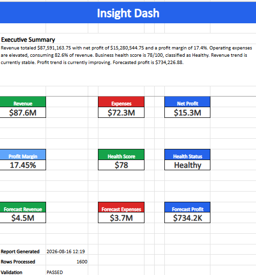

# Insight Dash: Executive Financial Dashboard (v2.0)

An end-to-end Python financial analytics application that transforms business CSV data into actionable KPIs, health scoring, insights, statistical forecasting, and a presentation-ready Excel dashboard.

## 📈 Core Engine Performance & Output Metrics

When executed, Insight Dash validates the uploaded dataset, calculates financial metrics, generates business insights, and produces an executive report.

### ⚙️ Operational Throughput

* **Records Processed:** 1,600 historical financial records

* **Validation Status:** PASSED (automated dataset validation)

### 📊 Calculated Financial KPIs

* **Total Revenue:** $87,591,163.75

* **Total Operating Expenses:** $72,310,619.00

* **Net Profit:** $15,280,544.75

* **Profit Margin:** 17.45%

### 🤖 Business Intelligence

* **Business Health Score:** 78 / 100

* **System Status:** "Healthy"

* **Statistical Forecasting:** Configurable forecast horizons including Next Month, Next Quarter, Next 6 Months, and Next Year.

---

## 🛠️ Tech Stack & Core Libraries

* **pandas** - Data ingestion, cleaning, validation, and financial KPI calculations.

* **NumPy** - Statistical trend calculations used by the forecasting engine.

* **Streamlit** - Interactive executive analytics application and dashboard interface.

* **openpyxl** - Excel workbook generation, formatting, and dashboard construction.

---

## 📊 Dashboard Preview

> 

---

## 🚀 Quick Start & Installation

### 1. Clone the Repository

```bash
git clone https://github.com
cd Insight-Dash
```

### 2. Install Dependencies

```bash
pip install -r requirements.txt
```

### 3. Run the Application

```bash
streamlit run app.py
```

## Upload a supported CSV dataset, select the forecast period, and click **Analyze Business** to generate the financial analysis and downloadable Excel report.
